# Лабораторная работа 6 — CLI‑утилиты с argparse (cat/grep‑lite + конвертеры)

## Содержание
 
1. [Цель работы](#цель-работы)
2. [Задание 1. Модуль cli_text.py](#задание-1-модуль-cli_textpy)
3. [Задание 2. Модуль cli_convert.py](#задание-2-модуль-cli_convertpy)
4. [Обработка ошибок](#обработка-ошибок)
5. [Краевые случаи](#краевые-случаи)

## Цель работы
 
Научиться создавать консольные инструменты с аргументами командной строки, подкомандами и флагами.
Основная задача — обернуть существующие функции конвертации и анализа текста в CLI‑оболочки с помощью argparse.
 
## Задание 1. Модуль cli_text.py
 
Подкоманды:
    cat --input <path> [-n] — вывод содержимого файла построчно (с нумерацией при -n)
    stats --input <txt> [--top 5] — анализ частот слов в тексте (использовать функции из lab03)

<details>
<summary>Код src/lab06/cli_text.py</summary>

```python
import argparse
from pathlib import Path
import sys

from src.lib.text import normalize, tokenize, count_freq, top_n


def main():
    """
    1. Анализирует частоты слов в тексте, выводит ТОП-n слов (используются функции из lab03).
    2. Выводит содержимое файла построчно (с нумерацией при -n).
    
    Подкоманды:
        stats --input ПУТЬ [--top N]
            Печатает N самых частых слов файла (по умолчанию 5). Текст
            нормализуется и разбивается на слова функциями из src.lib.text.
        cat --input ПУТЬ [-n]
            Печатает файл построчно; с флагом -n строки нумеруются с 1.

    Файлы читаются в кодировке UTF-8. Результат выводится в stdout,
    сообщения об ошибках в stderr.
    
    Raises:
        SystemExit: код 2, если аргументы неверны (подкоманда не указана,
            нет --input, значение --top не число или не больше нуля);
            код 1, если файл не найден (FileNotFoundError), не в UTF-8
            (UnicodeDecodeError) или не удалось его прочитать (OSError:
            путь указывает на папку, нет прав доступа и т. п.).

    """
    parser = argparse.ArgumentParser(description="CLI-утилиты лабораторной №6")
    subparsers = parser.add_subparsers(dest="command", required=True)

    cat_parser = subparsers.add_parser("cat", help="Вывод содержимого файла построчно")
    cat_parser.add_argument("--input", required=True, help="Путь к файлу")
    cat_parser.add_argument("-n", action="store_true", help="Нумеровать строки")
    
    stats_parser = subparsers.add_parser("stats", help="Анализ частот слов в тексте")
    stats_parser.add_argument("--input", required=True, help="Путь к файлу с текстом")
    stats_parser.add_argument("--top", type=int, default=5, help="Количество ТОП-элементов")

    args = parser.parse_args()

    try:
        if args.command == "stats":
            if args.top <= 0:
                stats_parser.error("Введите корректное значение top (>0)")
        
            with Path(args.input).open("r", encoding="utf-8") as f:
                text = f.read()
                token_text = tokenize(normalize(text))
                freq = count_freq(token_text)
                top_words = top_n(freq, args.top)
            print(f"Топ-{min(args.top, len(top_words))} слов:")
            place = 1
            for word, freq_for_word in top_words:
                print(f"{place}. {word} - {freq_for_word}")
                place += 1

        elif args.command == "cat":
            with Path(args.input).open("r", encoding="utf-8") as f:
                if args.n:
                    n = 1
                    for line in f:
                        line = line.strip("\n")
                        print(f'{n}. {line}')
                        n += 1
                else:
                    for line in f:
                        line = line.strip("\n")
                        print(line)
    except UnicodeDecodeError:
        print(f"Ошибка: файл '{args.input}' не является UTF-8 текстом. Ошибка UnicodeDecodeError.", file=sys.stderr)
        sys.exit(1)
    except FileNotFoundError:
        print(f'Файл "{args.input}" не найден. Ошибка FileNotFoundError.', file=sys.stderr)
        sys.exit(1)
    except OSError as e:
        print(f'Ошибка {e}. Проверьте путь к файлу "{args.input}".', file=sys.stderr)
        sys.exit(1)


if __name__ == "__main__":
    main()
```
 
</details>

### Подкоманда cat

Параметры:
    --input - путь к входному файлу - обязательный
    -n - флаг использования нумерации строк - необязательный(по умолчанию - False)

Скриншот 1. Содержание исходного файла people.csv

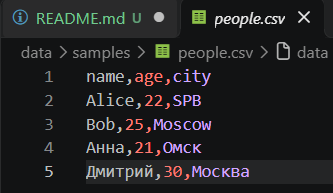

```powershell
py -m src.lab06.cli_text cat --input data/samples/people.csv
```

Скриншот 2. Стандартный вывод cat

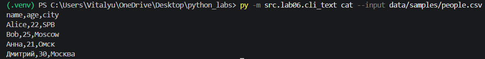

```powershell
py -m src.lab06.cli_text cat --input data/samples/people.csv -n
```

Скриншот 3. Нумерованный вывод cat

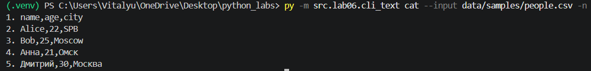

### Подкоманда stats

Параметры:
    --input - путь к входному файлу - обязательный
    --top - количество слов в топе(ТОП-n) - не обязательный(по умолчанию - 5)

Скриншот 4. Содержание исходного файла people.txt

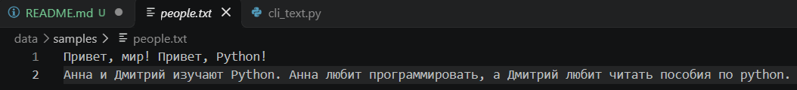

Скриншот 5. Стандартный вывод stats

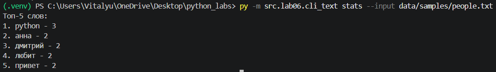

Скриншот 6. Вывод stats(ТОП-10)

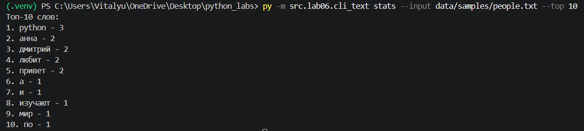

### --help

```powershell
py -m src.lab06.cli_text --help
```
Скриншот 12. --help для cli_text

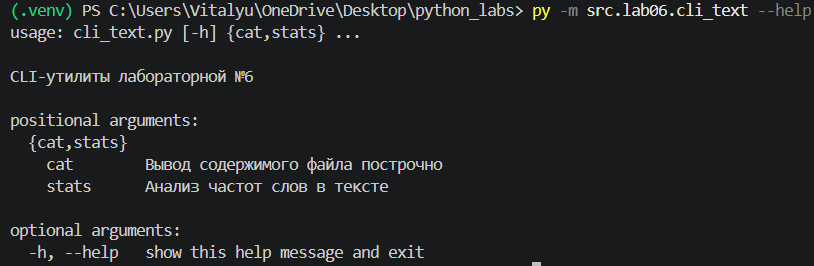

## Задание 2. Модуль cli_convert.py

Подкоманды:
    csv2json - Конвертация csv -> json
    json2csv - Конвертация json -> csv
    csv2xlsx - Конвертация csv -> xlsx

<details>
<summary>Код src/lab05/cli_convert.py</summary>

```python
import argparse
import sys
 
from src.lab05.json_csv import csv_to_json, json_to_csv
from src.lab05.csv_xlsx import csv_to_xlsx
 
 
def main():
    """
    Конвертирует файлы (json <-> csv, csv -> xlsx).
 
    Подкоманды:
        csv2json --in Путь к исходному файлу --out Путь к файлу записи
            Конвертация csv -> json
        json2csv --in Путь к исходному файлу --out Путь к файлу записи
            Конвертация json -> csv
        csv2xlsx --in Путь к исходному файлу --out Путь к файлу записи
            Конвертация csv -> xlsx
 
    Файлы читаются в кодировке UTF-8. При успехе в stdout печатается
    строка "Готово: ...", сообщения об ошибках выводятся в stderr.
 
    Raises:
        SystemExit: код 2, если аргументы неверны (подкоманда не указана,
            нет --in или --out, неизвестный параметр);
            код 1, если файл не найден (FileNotFoundError), не в UTF-8
            (UnicodeDecodeError), данные не подходят для конвертации
            (ValueError: неверное расширение, пустой или некорректный
            файл) или не удалось прочитать/записать файл (OSError:
            путь указывает на папку, нет прав доступа и т. п.).
    """
    parser = argparse.ArgumentParser(description="Конвертеры данных")
    subparser = parser.add_subparsers(dest="function", required=True)
 
    function1 = subparser.add_parser("csv2json", help="Конвертер из csv в json")
    function1.add_argument("--in", dest="input", required=True, help="Путь к файлу csv")
    function1.add_argument("--out", dest="output", required=True, help="Путь к файлу json")
 
    function2 = subparser.add_parser("json2csv", help="Конвертер из json в csv")
    function2.add_argument("--in", dest="input", required=True, help="Путь к файлу json")
    function2.add_argument("--out", dest="output", required=True, help="Путь к файлу csv")
 
    function3 = subparser.add_parser("csv2xlsx", help="Конвертер из csv в xlsx")
    function3.add_argument("--in", dest="input", required=True, help="Путь к файлу csv")
    function3.add_argument("--out", dest="output", required=True, help="Путь к файлу xlsx")
 
    args = parser.parse_args()
 
    try:
        if args.function == "csv2json":
            csv_to_json(args.input, args.output)
        elif args.function == "json2csv":
            json_to_csv(args.input, args.output)
        elif args.function == "csv2xlsx":
            csv_to_xlsx(args.input, args.output)
        print(f'Готово: "{args.input}" -> "{args.output}"')
 
    except FileNotFoundError:
        missing = args.input
        print(f'Путь "{missing}" не найден. Ошибка FileNotFoundError.', file=sys.stderr)
        sys.exit(1)
    except UnicodeDecodeError:
        print(f"Ошибка: файл '{args.input}' не является UTF-8 текстом. Ошибка UnicodeDecodeError.", file=sys.stderr)
        sys.exit(1)
    except ValueError as e:
        print(f"Ошибка: {e}. Ошибка ValueError.", file=sys.stderr)
        sys.exit(1)
    except OSError as e:
        print(f'Ошибка {e}. Проверьте пути к файлам: "{args.input}"; "{args.output}".', file=sys.stderr)
        sys.exit(1)
 
 
if __name__ == "__main__":
    main()
 
```
 
</details>

### Подкоманда csv2json

Параметры:
    --in Путь к исходному файлу 
    --out Путь к файлу записи

Скриншот 7. Входные данные cska_players.csv

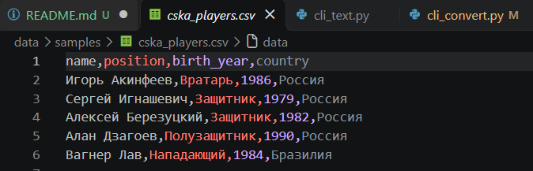

```powershell
py -m src.lab06.cli_convert csv2json --in data/samples/cska_players.csv --out data/out/cska_players_from_csv.json
```

Скриншот 8. Файл cska_players_from_csv.json на выходе

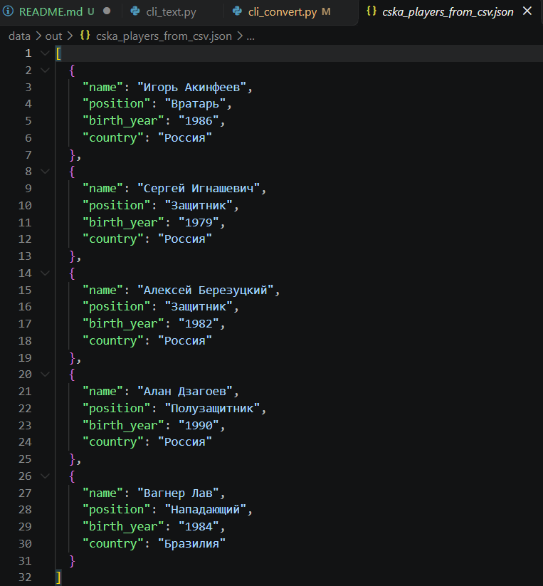

### Подкоманда json2csv

Параметры:
    --in Путь к исходному файлу 
    --out Путь к файлу записи

Входные данные  - cska_players_from_csv.json(скриншот выше)

```powershell
py -m src.lab06.cli_convert json2csv --in data/out/cska_players_from_csv.json --out data/out/cska_players_from_from.csv
```

Скриншот 9. Файл cska_players_from_from.csv на выходе

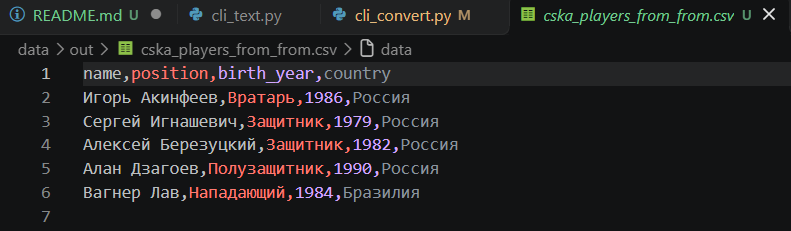

### Подкоманда csv2xlsx

Параметры:
    --in Путь к исходному файлу 
    --out Путь к файлу записи

Скриншот 10. Входные данные cska_matches.csv

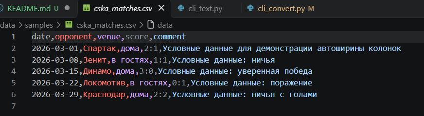

```powershell
py -m src.lab06.cli_convert csv2xlsx --in data/samples/cska_matches.csv --out data/out/cska_matches.xlsx
```

Скриншот 11. Файл cska_matches.xlsx на выходе

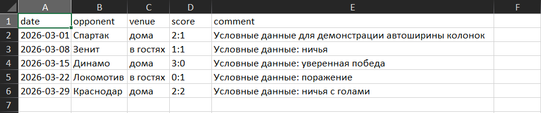
 
### --help

```powershell
py -m src.lab06.cli_convert --help
```
Скриншот 12. --help для cli_convert

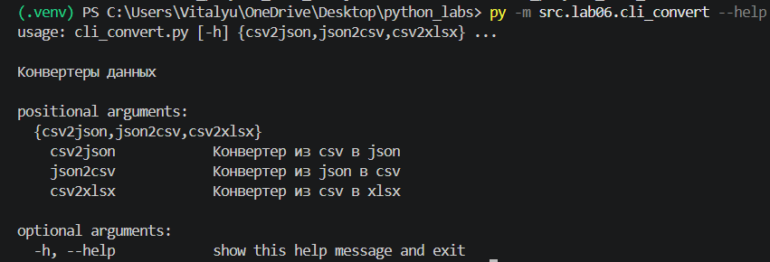

## Обработка ошибок

В обоих CLI-модулях ошибки разделяются на две основные группы: ошибки ввода команды и ошибки, возникающие во время чтения, обработки или записи файлов.

### Ошибки аргументов командной строки

За проверку аргументов отвечает библиотека `argparse`. Если пользователь не указал подкоманду, не передал обязательный параметр (`--input`, `--in` или `--out`), использовал неизвестный параметр либо передал для `--top` значение, которое нельзя преобразовать в целое число, программа выводит справку с описанием ошибки в `stderr` и завершается с кодом **2**.

Для подкоманды `stats` дополнительно проверяется, что `--top` больше нуля. При значении `0` или отрицательном числе вызывается `stats_parser.error(...)`; это также приводит к завершению с кодом **2**.

### Ошибки в модуле `cli_text.py`

При работе с файлами предусмотрена обработка следующих исключений:

| Исключение | Когда возникает | Поведение программы |
|---|---|---|
| `FileNotFoundError` | Файл по указанному пути не существует | Сообщение о том, что входной файл не найден, выводится в `stderr`; код завершения — **1**. |
| `UnicodeDecodeError` | Содержимое файла не удаётся декодировать как UTF-8 | Выводится сообщение о неподходящей кодировке; код завершения — **1**. |
| `OSError` | Файл невозможно прочитать, например из-за отсутствия прав доступа или если вместо файла указана папка | Выводится системное сообщение об ошибке и рекомендация проверить путь; код завершения — **1**. |

Сообщения об ошибках направляются в `stderr`, а обычный результат команд `cat` и `stats` — в `stdout`. Это позволяет отделять результат работы утилиты от диагностической информации.

### Ошибки в модуле `cli_convert.py`

Конвертер обрабатывает следующие исключения:

| Исключение | Когда возникает | Поведение программы |
|---|---|---|
| `FileNotFoundError` | Не найден входной файл либо не удалось создать выходной файл из-за отсутствующей части пути | Выводится сообщение о ненайденном пути; код завершения — **1**. |
| `UnicodeDecodeError` | Входной CSV/JSON-файл не соответствует UTF-8 | Выводится сообщение о проблеме с кодировкой; код завершения — **1**. |
| `ValueError` | Конвертер обнаружил неподходящее расширение, пустые или некорректные данные | Выводится текст исключения; код завершения — **1**. Ошибка разбора JSON (`JSONDecodeError`) также относится к `ValueError` и попадает в этот обработчик, если не перехватывается раньше внутри функции конвертации. |
| `OSError` | Возникла ошибка чтения или записи: недостаточно прав, путь указывает на папку или произошла другая системная ошибка | Выводится сообщение с путями входного и выходного файлов; код завершения — **1**. |

Если конвертация завершилась успешно, программа выводит в `stdout` сообщение `Готово: "входной_файл" -> "выходной_файл"`.

**Итог:** код завершения **0** означает успешное выполнение; код **1** используется для ошибок при работе с файлами или данными; код **2** — для ошибок в команде и её аргументах.

## Краевые случаи

При проверке утилит важно учитывать ситуации, которые не обязательно являются ошибками, но влияют на результат работы.

### Краевые случаи `cat` и `stats`

- **Пустой файл.** Команда `cat` не выводит строк, так как в файле нет содержимого. Команда `stats` не находит слов и выводит заголовок `Топ-0 слов:` без списка результатов.
- **Пустые строки.** В `cat -n` пустые строки тоже нумеруются, поскольку нумерация выполняется для каждой прочитанной строки файла.
- **Пробелы и пустые строки в тексте.** Команда `cat` сохраняет содержимое строк; метод `strip("\n")` удаляет символ перевода строки, но не удаляет пробелы в начале и конце строки.
- **Значение `--top` больше числа различных слов.** Будут выведены только те слова, которые реально присутствуют в частотном словаре. Количество в заголовке определяется фактическим числом элементов, а не только значением аргумента.
- **`--top` равно нулю или отрицательно.** Это недопустимое значение; программа сообщает об ошибке аргумента и завершается с кодом **2**.
- **Текст без распознаваемых слов.** Например, файл может содержать только пробелы, знаки пунктуации или цифры. После нормализации и токенизации список слов может оказаться пустым, поэтому статистика будет пустой.
- **Большой файл.** `cat` читает файл построчно, поэтому не загружает всё содержимое в память одновременно. `stats`, напротив, использует `f.read()` и загружает весь текст целиком; для очень больших файлов это может потребовать значительный объём оперативной памяти.
- **Относительный путь.** Относительные пути (`data/samples/people.csv`) интерпретируются относительно текущей рабочей директории, из которой запущена команда. Если запускать модуль из другой директории, файл может не найтись.

### Краевые случаи конвертеров

- **Пустой входной файл.** Согласно описанию `cli_convert.py`, пустые или некорректные данные могут приводить к `ValueError`. В таком случае программа выводит сообщение в `stderr` и завершается с кодом **1**.
- **Неверное расширение.** Если передан файл с расширением, которое не соответствует выбранной операции, конвертер может отклонить его через `ValueError`. Проверка расширений выполняется функциями конвертации, а не самим `argparse`-интерфейсом.
- **Некорректный JSON.** При ошибке синтаксиса JSON возникает `JSONDecodeError` (наследник `ValueError`); если исключение доходит до CLI-обёртки, оно обрабатывается блоком `except ValueError`.
- **Неверная кодировка.** Текстовые входные CSV/JSON-файлы должны читаться как UTF-8. Файл в другой кодировке приводит к `UnicodeDecodeError`, который обрабатывается отдельно.
- **Недостаточно прав на запись.** Если у программы нет разрешения создавать или перезаписывать файл в выбранной папке, возникает `OSError`; пользователь получает сообщение с путями входного и выходного файлов.
- **Большие наборы данных.** Время конвертации и потребление памяти зависят от реализации функций `csv_to_json`, `json_to_csv` и `csv_to_xlsx`. В представленном CLI-коде отдельного ограничения размера входных файлов нет.

### Что следует проверить дополнительно

Для проверки обработки ошибок можно выполнить несколько тестов:

```powershell
# Неуказана подкоманда — ожидается код 2
py -m src.lab06.cli_text
```
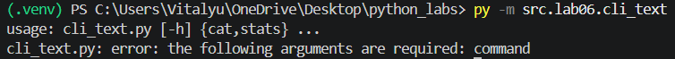

```powershell
# Несуществующий входной файл — ожидается код 1
py -m src.lab06.cli_text cat --input data/samples/missing.csv
```
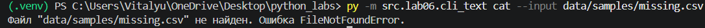

```powershell
# Некорректное значение --top — ожидается код 2
py -m src.lab06.cli_text stats --input data/samples/people.txt --top 0
```
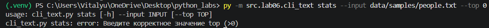

```powershell
# Не указан выходной путь — ожидается код 2
py -m src.lab06.cli_convert csv2json --in data/samples/cska_players.csv
```
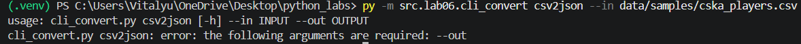

```powershell
# Указана папка, а не файл - ожидается код 1
py -m src.lab06.cli_convert csv2json --in data/samples --out data/out/file.json
```
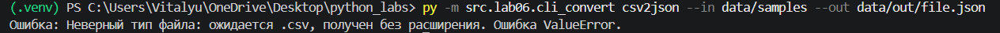
