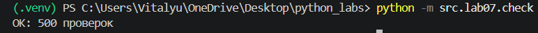
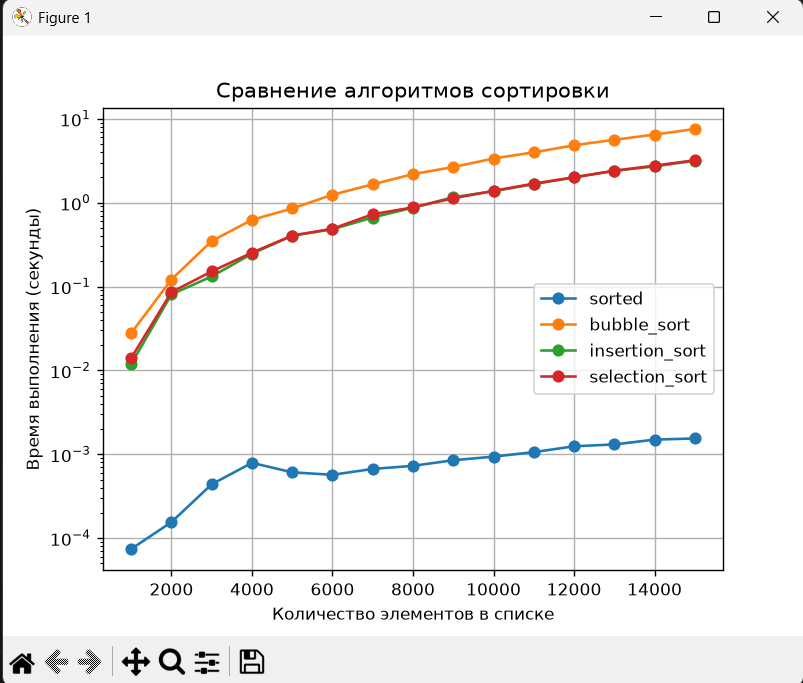

# Лабораторная работа 7 — Алгоритмы сортировки и поиска

## Содержание

1. [Цель работы](#цель-работы)
2. [Задание 1. Алгоритмы сортировки](#задание-1-алгоритмы-сортировки)
3. [Задание 2. Алгоритмы поиска](#задание-2-алгоритмы-поиска)
4. [Задание 3. Поиск пары чисел по сумме (Two Sum)](#задание-3-поиск-пары-чисел-по-сумме-two-sum)
5. [Проверка корректности алгоритмов](#проверка-корректности-алгоритмов)
6. [Сравнение производительности](#сравнение-производительности)
7. [График времени выполнения сортировок](#график-времени-выполнения-сортировок)
8. [Итоги работы](#итоги-работы)

## Цель работы

Изучить и реализовать основные алгоритмы сортировки и поиска элементов в списках, сравнить их корректность и производительность.

В рамках лабораторной работы реализованы три алгоритма сортировки, два алгоритма поиска элемента и два способа решения задачи Two Sum. Для проверки корректности написаны автоматические тесты, а для сравнения скорости выполнения проведены измерения с использованием модуля `timeit`.

## Задание 1. Алгоритмы сортировки

В модуле `src/lab07/sorting.py` реализованы три алгоритма сортировки:

- **Bubble Sort (сортировка пузырьком)** — последовательное сравнение соседних элементов и обмен их местами, если они расположены в неправильном порядке. Если за проход обменов не было, алгоритм завершает работу досрочно.
- **Insertion Sort (сортировка вставками)** — последовательное добавление каждого элемента в подходящее место уже отсортированной части списка.
- **Selection Sort (сортировка выбором)** — поиск минимального элемента в неотсортированной части списка и его перестановка в начало этой части.

Все три функции возвращают новый отсортированный список, не изменяя исходный список.

<details>
<summary>Код src/lab07/sorting.py</summary>

```python
def bubble_sort(nums: list[int]) -> list[int]:
    """Сортировка пузырьком

    Args:
        nums (list): неотсортированный список чисел

    Returns:
        list: отсортированный список nums
    """    
    nums = list(nums)
    for i in range(len(nums)):
        thats_all = True
        for j in range(len(nums) - i - 1):
            if nums[j] > nums[j+1]:
                nums[j], nums[j+1] = nums[j+1], nums[j]
                thats_all = False
        if thats_all:
            return nums
    return nums


def insertion_sort(nums: list[int]) -> list[int]:
    """Сортировка вставками

    Args:
        nums (list): неотсортированный список чисел

    Returns:
        list: отсортированный список nums
    """
    nums = list(nums)
    for insert_index in range(1, len(nums)):
        insert_element  = nums[insert_index]
        left_border = insert_index - 1
        while left_border >= 0 and nums[left_border] > insert_element:
            nums[left_border + 1] = nums[left_border]
            left_border -= 1
        nums[left_border + 1] = insert_element
    return nums
    
def selection_sort(nums: list[int]) -> list[int]:
    """Сортировка выбором

    Args:
        nums (list): неотсортированный список чисел

    Returns:
        list: отсортированный список nums
    """
    nums = list(nums)
    for index in range(len(nums)):
        min_el = index
        for el in range(index + 1, len(nums)):
            if nums[el] < nums[min_el]:
                min_el = el
        nums[index], nums[min_el] = nums[min_el], nums[index]
    return nums
```

</details>

### Проверка сортировок

Для каждой сортировки выполняется 100 случайных проверок. Результат работы сравнивается со встроенной функцией `sorted()`. Дополнительно проверяется, что исходный список не был изменён.

## Задание 2. Алгоритмы поиска

В модуле `src/lab07/search.py` реализованы два алгоритма поиска элемента.

- **Linear Search (линейный поиск)** — последовательная проверка элементов списка до нахождения искомого значения. Если элемент найден, функция возвращает его индекс. Если элемент отсутствует, возвращается `-1`.
- **Binary Search (бинарный поиск)** — поиск элемента в отсортированном списке путём последовательного деления рассматриваемого диапазона пополам. На каждом шаге исключается половина оставшихся элементов.

Для бинарного поиска входной список должен быть отсортирован заранее. Функция возвращает индекс найденного элемента в переданном отсортированном списке либо `-1`, если элемент отсутствует.

## Задание 3. Поиск пары чисел по сумме (Two Sum)

В том же модуле `src/lab07/search.py` реализованы два решения задачи Two Sum.

Задача заключается в поиске двух различных элементов списка, сумма которых равна заданному значению `target`. Функции возвращают пару индексов найденных элементов `(i, j)`, где `i < j`. Если подходящая пара отсутствует, возвращается `None`.

- **two_sum_brute** — решение методом грубой силы. Используются два вложенных цикла, которые перебирают все возможные пары элементов.
- **two_sum_fast** — решение с использованием словаря. Для каждого элемента вычисляется необходимое дополнительное значение (`target - num`), после чего проверяется, встречалось ли оно ранее.

<details>
<summary>Код src/lab07/search.py</summary>

```python
def linear_search(nums, x) -> int:
    """Линейный поиск

    Args:
        nums (list): список чисел
        x (int): искомый элемент

    Returns:
        int: индекс искомого элемента
    """
    for number, element in enumerate(nums):
        if element == x:
            return number
    return -1


def binary_search(sorted_nums, x) -> int:
    """Бинарный поиск

    Args:
        sorted_nums (list): отсортированный список чисел
        x (int): искомый элемент

    Returns:
        int: индекс искомого элемента
    """
    
    lo, hi = 0, len(sorted_nums) - 1
    while lo <= hi:
        mid = (lo + hi) // 2
        if sorted_nums[mid] == x:
            return mid
        elif x > sorted_nums[mid]:
            lo = mid + 1
        else:
            hi = mid - 1
    return -1


def two_sum_brute(nums, target) -> tuple[int, int] | None:
    """Two sum методом грубой силы

    Args:
        nums (list): список чисел
        target (int): необходимая сумма

    Returns:
        tuple[int, int]: индексы i и j подходящих чисел (i < j)
        None: в списке нет подходящей пары чисел
    """
    for i in range(len(nums)):
        for j in range(i+1, len(nums)):
            if nums[i] + nums[j] == target:
                return (i, j)
    return None


def two_sum_fast(nums, target) -> tuple[int, int] | None:
    """Two sum через словари

    Args:
        nums (list): список чисел
        target (int): необходимая сумма

    Returns:
        tuple[int, int]: индексы i и j подходящих чисел (i < j)
        None: в списке нет подходящей пары чисел
    """
    seen = {}
    for i, num in enumerate(nums):
        complement = target - num
        if complement in seen:
            return (seen[complement], i)
        seen[num] = i
    return None
```

</details>

## Проверка корректности алгоритмов

Для автоматической проверки реализован модуль `src/lab07/check.py`.

Проверки разделены на три группы:

1. `check_sorting()` — проверяет корректность сортировок и отсутствие изменений исходного списка.
2. `check_search()` — проверяет результаты линейного и бинарного поиска.
3. `check_two_sum()` — проверяет результаты двух реализаций поиска пары чисел.

Для генерации случайных данных используется модуль `random`. В тестах проверяются списки различной длины и числа из заданных диапазонов.

Код проверки:

<details>
<summary>Код src/lab07/check.py</summary>

```python
import random
from src.lab07.sorting import bubble_sort, insertion_sort, selection_sort
from src.lab07.search import linear_search, binary_search, two_sum_brute, two_sum_fast


def check_sorting(func, trials=100) -> int:
    """Проверка работы сортировок

    Args:
        func (function): функция - выбранный способ сортировки
        trials (int): количество проверок. Значение по умолчанию - 100.

    Returns:
        int: количество пройденных тестов
    """
    for _ in range(trials):
        len_list = random.randint(0,50)
        try_list = [random.randint(-100, 100) for _ in range(len_list)]
        not_srt_lst = list(try_list)
        srt_lst = func(try_list)
        assert srt_lst == sorted(not_srt_lst), f"{func.__name__} ошиблась на {try_list}: {srt_lst}"
        assert try_list == not_srt_lst, f"{func.__name__} изменила исходный список"
    return trials


def check_search() -> int:
    """Проверка работы поиска

    Returns:
        int: количество пройденных тестов
    """
    trials = 100
    for _ in range(trials):
        nums = [random.randint(-50, 50) for _ in range(random.randint(0, 42))]
        target = random.randint(-60, 60)
        func_result = linear_search(nums, target)
        try:
            index_result = nums.index(target)
        except ValueError:
            index_result = -1
        assert func_result == index_result, f"linear_search ошибся при поиске {target} в {nums}"
        
        srt_nums = sorted(nums)
        bin_result = binary_search(srt_nums, target)
        try:
            index_result = srt_nums.index(target)
        except ValueError:
            index_result = -1
        assert bin_result == index_result, f"binary_search ошибся при поиске {target} в {srt_nums}"
    return trials


def check_two_sum(trials=100) -> int:
    """Проверка работы поиска пары по сумме

    Args:
        trials (int): количество проверок. Значение по умолчанию - 100.

    Returns:
        int: количество пройденных тестов
    """
    for _ in range(trials):
        nums = [random.randint(-50, 50) for _ in range(random.randint(2, 42))]
        target = random.randint(-101, 101)
        brute_result = two_sum_brute(nums, target)
        fast_result = two_sum_fast(nums, target)
        if brute_result is None:
            assert fast_result is None, f"Результат two_sum_fast и two_sum_brute не совпадают на {nums}, при требуемом {target}. two_sum_fast нашел пару, two_sum_brute - нет"
        else:
            bi, bj = brute_result
            assert nums[bi] + nums[bj] == target, f"two_sum_brute нашел неверную пару {brute_result} в {nums}, при требуемой сумме {target}"
            assert fast_result is not None, f"Результат two_sum_fast и two_sum_brute не совпадают на {nums}, при требуемом {target}. two_sum_brute нашел пару, two_sum_fast - нет"
            fi, fj = fast_result
            assert nums[fi] + nums[fj] == target, f"two_sum_brute верно нашел пару, two_sum_fast - нет: {fast_result} в {nums}, при требуемой сумме {target}"
    return trials
        
if __name__ == "__main__":
    random.seed(42)
    attempts = 0
    for func in (bubble_sort, insertion_sort, selection_sort):
        attempts += check_sorting(func)
    attempts += check_search()
    attempts += check_two_sum()
    print(f"OK: {attempts} проверок")
```

</details>

Запуск проверки из корневой директории проекта:

```powershell
py -m src.lab07.check
```

При успешном прохождении проверок программа должна вывести:

```text
OK: 500 проверок
```

**Скриншот 1. Результат выполнения `check.py`**



## Сравнение производительности

Для измерения времени выполнения алгоритмов создан модуль `src/lab07/bench.py`. Для измерений используется модуль `timeit`.

Перед запуском измерений устанавливается фиксированное значение генератора случайных чисел (`random.seed(42)`), чтобы обеспечить воспроизводимость исходных данных.

### Сравнение сортировок

Время выполнения сортировок измеряется для списков следующих размеров: 1 000, 10 000 и 100 000 элементов. В качестве встроенной реализации для сравнения используется функция `sorted()`.

Для списков размером 100 000 элементов пользовательские алгоритмы сортировки не запускаются: в таблицу записывается отметка `>60`. Это условная отметка, записанная в коде, а не фактически измеренное время выполнения.

### Сравнение алгоритмов поиска

Для поиска используется список из 100 000 элементов и 10 000 целевых значений. Сравниваются линейный и бинарный поиск. Перед бинарным поиском список сортируется, а время сортировки учитывается отдельно. Время поиска в таблице представляет собой сумму времени выполнения 10 000 отдельных запросов.

### Сравнение решений Two Sum

Для двух реализаций Two Sum измеряется время выполнения на списках размером 1 000 и 10 000 элементов. Целевое значение формируется как сумма элементов с индексами 1 и 42, поэтому для используемых размеров списка подходящая пара существует.

<details>
<summary>Код src/lab07/bench.py</summary>

```python
import random
import timeit
from src.lab04.io_txt_csv import write_csv
from src.lab07.sorting import bubble_sort, insertion_sort, selection_sort
from src.lab07.search import linear_search, binary_search, two_sum_brute, two_sum_fast


def main():

    random.seed(42)

    def bench_sorts(n):
        """Бенчмарк сортировок

        Args:
            n(int): количество элементов в списке

        Returns:
            list: список с результатами
        """    
        data = [random.randint(-1_000_000, 1_000_000) for _ in range(n)]
        rows = []
        x = timeit.timeit(lambda:sorted(data), number=1)
        rows.append(("sort", n, "sorted", x))
        if n <= 10000:
            x = timeit.timeit(lambda:bubble_sort(data), number=1)
            rows.append(("sort", n, "bubble_sort", x))
            x = timeit.timeit(lambda:insertion_sort(data), number=1)
            rows.append(("sort", n, "insertion_sort", x))
            x = timeit.timeit(lambda:selection_sort(data), number=1)
            rows.append(("sort", n, "selection_sort", x))
        else:
            rows.append(("sort", n, "bubble_sort", '>60'))
            rows.append(("sort", n, "insertion_sort", '>60'))
            rows.append(("sort", n, "selection_sort", '>60'))
        return rows

    def bench_search():
        """Бенчмарк алгоритмов поиска

        Returns:
            list: список с результатами
        """    
        data_size = 100_000
        targets_quantity = 10_000
        data = [random.randint(-1_000_000, 1_000_000) for _ in range(data_size)]
        targets = [random.choice(data) for _ in range(targets_quantity)]
        rows = []
        type_time = 0
        for target in targets:
            x = timeit.timeit(lambda:linear_search(data, target), number=1)
            type_time += x
        rows.append(("search", data_size, "linear_search", type_time))
        type_time = 0
        x = timeit.timeit(lambda:sorted(data), number=1)
        sorted_data = sorted(data)
        rows.append(("sort", data_size, "sorted(for binary)", x))
        type_time = 0
        for target in targets:
            x = timeit.timeit(lambda:binary_search(sorted_data, target), number=1)
            type_time += x
        rows.append(("search", data_size, "binary_search", type_time))
        return rows

    def bench_two_sum(n):
        """Бенчмарк алгоритмов решения two_sum 

        Args:
            n(int): количество элементов в списке

        Returns:
            list: список с результатами
        """    
        data = [random.randint(-1_000_000, 1_000_000) for _ in range(n)]
        target = data[1] + data[42]
        rows = []
        x = timeit.timeit(lambda:two_sum_brute(data, target), number=1)
        rows.append(('two_sum', n, 'two_sum_brute', x))
        x = timeit.timeit(lambda:two_sum_fast(data, target), number=1)
        rows.append(('two_sum', n, 'two_sum_fast', x))
        return rows

    def get_rows():
        """Функция собирает все результаты в один список

        Returns:
            list: список со всеми результатами всех бенчмарков
        """    
        all_rows = []
        all_rows.extend(bench_sorts(1_000))
        all_rows.extend(bench_sorts(10_000))
        all_rows.extend(bench_sorts(100_000))
        all_rows.extend(bench_search())
        all_rows.extend(bench_two_sum(1_000))
        all_rows.extend(bench_two_sum(10_000))
        return all_rows

    csv_rows = get_rows()
    header = ("Task", "Length", "Method", "Time")
    write_csv(csv_rows, "data/lab07/bench.csv", header=header)

    max_len_t = max([len(str(x[3])) for x in csv_rows])
    print(f"| {'Task':<7} | {'Length':<6} | {'Method':<18} | {'Time'}" + (max_len_t-4)*' ' + ' |')
    print('—'*65)
    for t, l, m, ti in csv_rows:
        print(f"| {t:<7} | {l:<6} | {m:<18} | {ti}" + (max_len_t-len(str(ti)))*' ' + ' |')
        
if __name__ == "__main__":
    main()
```

</details>

### Таблица результатов бенчмарка

Результаты измерений сохраняются в CSV-файл `data/lab07/bench.csv`.

**Скриншот 2. Содержимое файла `bench.csv`**


**Скриншот 3. Вывод `bench.py`**


## График времени выполнения сортировок

Для визуального сравнения времени выполнения алгоритмов используется модуль `src/lab07/star_task/plot.py`. Для чтения и обработки CSV-файла применяется библиотека `pandas`, а для построения графика — `matplotlib.pyplot`.

На графике отображаются результаты для размеров списков от 1 000 до 15 000 элементов. По оси X откладывается количество элементов в списке, по оси Y — время выполнения в секундах. Для оси Y используется логарифмическая шкала, позволяющая сравнить значения, которые отличаются на несколько порядков.

<details>
<summary>Код src/lab07/plot.py</summary>

```python
import pandas as pd
import matplotlib.pyplot as plt

df = pd.read_csv("data/lab07/star_task/bench_for_plot.csv")
df = df[df["Task"] == "sort"]

for method in df["Method"].unique():
    if 'binary' in method: continue
    df_work = df[(df["Method"] == method) & (df["Length"] < 15001)]
    plt.plot(df_work["Length"], df_work["Time"], label=method.strip(), marker="o")
    
plt.yscale("log")
plt.xlabel("Количество элементов в списке")
plt.ylabel("Время выполнения (секунды)")
plt.title("Сравнение алгоритмов сортировки")
plt.legend()
plt.grid(True, which="major")
plt.show()
```

</details>

Запуск построения графика:

```powershell
py -m src.lab07.star_task.plot
```

**Скриншот 3. График сравнения алгоритмов сортировки**



## Итоги работы

В ходе лабораторной работы были реализованы три алгоритма сортировки: пузырьком, вставками и выбором. Также были реализованы линейный и бинарный поиск, а для задачи Two Sum — решение методом грубой силы и решение с использованием словаря. Корректность алгоритмов проверялась с помощью автоматических тестов на случайных данных. При успешном выполнении всех проверок программа выводит `OK: 500 проверок`.

Сравнение производительности показало, что среди реализованных сортировок на проверенных размерах списка быстрее всего отработала сортировка выбором, а пузырьковая сортировка оказалась самой медленной. Бинарный поиск значительно быстрее линейного при выполнении 10 000 запросов на отсортированном списке. Быстрая реализация Two Sum с использованием словаря также показала меньшее время выполнения по сравнению с методом грубой силы. Для трёх собственных сортировок на размере 100 000 элементов измерения не проводились — в таблице для них указана условная отметка `>60`.
