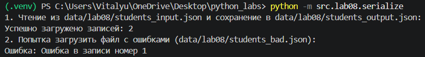
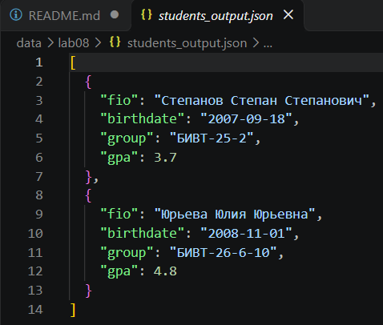

# ЛР8 - Модель данных без классов: запись Student как словарь, валидация и сериализация
## Содержание

- [Цель работы](#цель-работы)
- [Структура записи Student](#структура-записи-student)
- [Задание 1. Создание модели данных и валидация](#задание-1-создание-модели-данных-и-валидация)
  - [Исходный код models.py](#исходный-код-modelspy)
- [Задание 2. Сериализация и десериализация JSON](#задание-2-сериализация-и-десериализация-json)
  - [Политика обработки некорректных записей](#политика-обработки-некорректных-записей)
  - [Исходный код serialize.py](#исходный-код-serializepy)
- [Проверка работы программы](#проверка-работы-программы)
  - [Пример исходных данных](#пример-исходных-данных)
  - [Проверка некорректных данных](#проверка-некорректных-данных)
  - [Запуск](#запуск)
- [Скриншоты работы программы](#скриншоты-работы-программы)
- [Итоги работы](#итоги-работы)
## Цель работы

Изучить представление модели данных без использования классов.
Реализовать запись студента в виде словаря, функции создания и проверки
записей, а также сериализацию и десериализацию данных в формате JSON.

## Структура записи Student

Для хранения информации о студенте используется словарь со следующими
полями:

  Поле          Тип данных   Описание
  ------------- ------------ --------------------------------------
  `fio`         `str`        ФИО студента
  `birthdate`   `str`        Дата рождения в формате `YYYY-MM-DD`
  `group`       `str`        Учебная группа
  `gpa`         `float`      Средний балл

Набор полей задаётся константой:

``` python
STUDENT_FIELDS = ("fio", "birthdate", "group", "gpa")
```

Классы при реализации не используются. Вся работа с моделью выполняется
с помощью словарей и функций.

## Задание 1. Создание модели данных и валидация

В файле `src/lab08/models.py` реализованы функции для создания, проверки
и обработки записей студентов.

Основные функции:

-   `make_student(fio, birthdate, group, gpa)` --- создаёт словарь с
    данными студента и проверяет переданные значения.
-   `validate_student(rec)` --- проверяет тип записи, набор ключей и
    значения полей.
-   `student_age(rec, today=None)` --- вычисляет возраст студента в
    полных годах.
-   `format_student(rec)` --- формирует удобную для чтения строку с
    информацией о студенте.
-   `student_to_dict(rec)` --- проверяет запись и возвращает её копию.
-   `student_from_dict(d)` --- формирует запись из словаря и приводит
    GPA к типу `float`.

При проверке GPA допускаются целые и вещественные числа в диапазоне от 0
до 5. Булевы значения не принимаются. Дата рождения должна быть
корректной датой в формате ISO и не должна находиться в будущем. ФИО и
название группы должны быть непустыми строками.

### Исходный код `models.py`

```{=html}
<details>
```
```{=html}
<summary>
```
Показать полный исходный код
```{=html}
</summary>
```
``` python
from datetime import date

STUDENT_FIELDS = ("fio", "birthdate", "group", "gpa")

def make_student(fio, birthdate, group, gpa) -> dict:
    """Функция собирает запись о студенте, проверяя каждое поле.

    Принимает 4 блока данных о студенте: ФИО, дата рождения, группа, GPA.
    Проверяет введенные данные согласно условию, при ошибках возвращает ValueError с понятным сообщением.
    Возвращает готовую запись в виде словаря(dict)
    """
    # Валидация GPA
    if isinstance(gpa, (int, float)) and not isinstance(gpa, bool):
        gpa = float(gpa)
        if gpa < 0 or gpa > 5:
            raise ValueError(f"Значение GPA должно быть в диапазоне от 0.0 до 5.0, получено - {gpa}")
    else:
        raise ValueError(f"GPA должно быть в формате int | float, получено в {type(gpa)}")
    #Валидация группы
    if isinstance(group, str):
        group = group.strip()
        if not group:
            raise ValueError("Поле GROUP пустое")
    else:
        raise ValueError(f"GROUP должно быть в формате str, получено в {type(group)}")
    #Валидация даты
    if not isinstance(birthdate, str):
        raise ValueError("Дата должна быть введена в текстовом формате 'YYYY-MM-DD'")
    birthdate = birthdate.strip()
    try:
        date_date = date.fromisoformat(birthdate)
    except ValueError: 
        raise ValueError("Введена неверная дата. Дата ожидается в формате 'YYYY-MM-DD'")

    if date_date > date.today():
        raise ValueError("Дата рождения не может быть в будущем")
    #Валидация ФИО
    if isinstance(fio, str):
        fio = fio.strip()
        if not fio:
            raise ValueError("Поле FIO пустое")
    else:
        raise ValueError(f"FIO должно быть в формате str, получено в {type(fio)}")

    if len(fio.split()) < 2:
        raise ValueError("В ФИО должна быть хотя бы фамилия и имя")

    return {"fio": fio, "birthdate": birthdate, "group": group, "gpa": round(gpa, 2)}

def validate_student(rec):
    """Общая валидация готового словаря: проверка данных, проверка соответствия ключей(полей).

    Принимает готовую запись(словарь).
    Проверяет данные через make_student, проверяет соответсвие ключей и полей, ValueError при ошибках.
    Функция ничего не возвращает.

    """
    #Проверка набора ключей
    if not isinstance(rec, dict):
        raise ValueError(f"Запись должна быть словарем, получено - {type(rec)}")
    get = set(rec.keys())
    need = set(STUDENT_FIELDS)
    if get != need:
        missed = need - get
        extra = get - need
        raise ValueError(f"Ошибка формата записи. Пропущены поля: {missed}. Лишние поля: {extra}")
    #Проверка каждого значения
    make_student(rec["fio"], rec["birthdate"], rec["group"], rec["gpa"])

def student_age(rec, today=None):
    """Функция подсчета возраста студента.

    Принимает запись о студенте, сегодняшнюю дату(не обязательный параметр).
    Возвращает полный возраст студента, при ошибках - ValueError. 

    """
    today = today or date.today()
    birthday = date.fromisoformat(rec["birthdate"])
    if birthday > today:
        raise ValueError("Дата рождения не может быть в будущем")
    minus_year = 0
    if today.month <= birthday.month and today.day < birthday.day:
        minus_year += 1
    return today.year - birthday.year - minus_year

def student_to_dict(rec):
    validate_student(rec)
    rec_copy = rec.copy()
    return rec_copy

def student_from_dict(d):
    if not isinstance(d, dict):
        raise ValueError(f"Ожидался словарь, получено - {type(d)}")

    fio = d.get("fio")
    birthdate = d.get("birthdate")
    group = d.get("group")
    gpa = d.get("gpa")

    if isinstance(gpa, (int, float)) and not isinstance(gpa, bool):
        gpa = float(gpa)

    des_from_d = {
        "fio": fio,
        "birthdate": birthdate,
        "group": group,
        "gpa": gpa
    }

    validate_student(des_from_d)
    return des_from_d

def format_student(rec):
    #Обработка ФИО
    fio = rec["fio"]
    fio_split = fio.split()
    all_fio = fio_split[0].capitalize() +' '+ ''.join([x[0].upper()+'.' for x in fio_split[1:]])

    group = f"({rec['group']})"
    gpa = f"GPA {rec['gpa']}"
    age = f"{student_age(rec)} лет"

    return all_fio + ' ' + group + ', ' + age + ', ' + gpa

if __name__ == "__main__":
    student = make_student("Салфеткиненкочдияровский Иван Аннович", "2006-06-07", "БИВТ-26-6-1", 4.2)
    print("Создан студент:", student)

    print("Форматирование:", format_student(student))

    print("Возраст:", student_age(student))

    print("Попытка создать студента с неверным GPA")
    try:
        make_student("Вэльюэрророва Арина Рустемовна", "2006-01-01", "ИУ-5", 67.0)
    except ValueError as e:
        print(f"Перехвачена ожидаемая ошибка: {e}")
```

```{=html}
</details>
```
## Задание 2. Сериализация и десериализация JSON

В файле `src/lab08/serialize.py` реализованы две основные функции:

-   `students_to_json(students, path)` --- проверяет записи студентов и
    сохраняет их в JSON-файл.
-   `students_from_json(path)` --- загружает данные из JSON-файла,
    проверяет структуру и преобразует каждый элемент в запись Student.

При сохранении используется `json.dump()` с параметрами
`ensure_ascii=False` и `indent=2`. Благодаря этому кириллические символы
сохраняются в читаемом виде, а содержимое файла форматируется с
отступами.

Перед чтением и записью проверяется расширение файла. При сохранении
автоматически создаются необходимые родительские каталоги.

### Политика обработки некорректных записей

В работе используется строгая политика обработки ошибок: если обнаружена
некорректная запись, загрузка прекращается и генерируется `ValueError` с
номером записи. Некорректные записи не пропускаются.

### Исходный код `serialize.py`

```{=html}
<details>
```
```{=html}
<summary>
```
Показать полный исходный код
```{=html}
</summary>
```
``` python
import json
from pathlib import Path

from src.lab05.json_csv import check_suffix
from src.lab08.models import student_to_dict, student_from_dict
from src.lab04.io_txt_csv import read_text


def students_to_json(students, path):
    check_suffix(path, ".json")

    file = Path(path)
    file.parent.mkdir(parents=True, exist_ok=True)

    data = [student_to_dict(student) for student in students]

    with open(file, "w", encoding="utf-8") as f:
        json.dump(data, f, ensure_ascii=False, indent=2)


def students_from_json(path) -> list[dict]:
    check_suffix(path, ".json")

    students = read_text(path).strip()

    if not students:
        raise ValueError("Получен пустой файл")

    list_of_students = []
    try:
        students_load = json.loads(students)
    except json.JSONDecodeError:
        raise ValueError(f"Ошибка десериализации из файла {path}")

    if not isinstance(students_load, list):
        raise ValueError(f"Содержимое файла должно быть списком. Получено - {type(students_load)}")

    for num, student in enumerate(students_load):
        try:
            get_st = student_from_dict(student)
            list_of_students.append(get_st)
        except ValueError:
            raise ValueError(f"Ошибка в записи номер {num+1}")

    return list_of_students


if __name__ == "__main__":    
    input_file = "data/lab08/students_input.json"
    output_file = "data/lab08/students_output.json"
    bad_file = "data/lab08/students_bad.json"

    print(f"1. Чтение из {input_file} и сохранение в {output_file}:")
    try:
        students_list = students_from_json(input_file)
        print(f"Успешно загружено записей: {len(students_list)}") 
        students_to_json(students_list, output_file)
    except Exception as e:
        print(f"Ошибка: {e}")

    print(f"2. Попытка загрузить файл с ошибками ({bad_file}):")
    try:
        students_from_json(bad_file)
    except ValueError as e:
        print(f"Ошибка: {e}")
```

```{=html}
</details>
```
## Проверка работы программы

Для проверки используются три файла:

-   `students_input.json` --- файл с корректными данными.
-   `students_output.json` --- файл, полученный после сериализации
    загруженных записей.
-   `students_bad.json` --- файл с некорректными данными для проверки
    обработки ошибок.

### Пример исходных данных

Содержимое `students_input.json`:

``` json
[
  {
    "fio": "Степанов Степан Степанович",
    "birthdate": "2007-09-18",
    "group": "БИВТ-25-2",
    "gpa": 3.7
  },
  {
    "fio": "Юрьева Юлия Юрьевна",
    "birthdate": "2008-11-01",
    "group": "БИВТ-26-6-10",
    "gpa": 4.8
  }
]
```

После загрузки и повторного сохранения данные записываются в
`students_output.json` в виде массива JSON-объектов. Значения GPA
остаются числовыми, а кириллица сохраняется без экранирования.

### Проверка некорректных данных

В `students_bad.json` присутствуют ошибки: некорректная дата рождения,
строковое значение GPA и значение GPA за пределами допустимого
диапазона.

При загрузке этого файла программа прекращает обработку на первой
некорректной записи и сообщает её номер.

**Примечание:** в текущем коде проверка GPA выполняется раньше проверки
даты. Поэтому для представленного файла первой обнаруживается ошибка
строкового значения GPA, а не ошибка даты.

### Запуск

Из корневой директории проекта:

``` bash
py -m src.lab08.models
```

Запуск сериализации и десериализации:

``` bash
py -m src.lab08.serialize
```

## Скриншоты работы программы

**Скриншот 1.** Успешная загрузка студентов из `students_input.json` и
сохранение в `students_output.json`.


**Скриншот 2.** Проверка обработки некорректной даты рождения.



**Скриншот 3.** Проверка обработки недопустимого значения GPA.



## Итоги работы

В ходе лабораторной работы была реализована модель студента без
использования классов. Для хранения данных применяется словарь с
фиксированным набором полей.

Были реализованы функции создания и валидации записей, вычисления
возраста, форматирования информации и преобразования словарей. Также
реализованы сериализация и десериализация списка студентов в формате
JSON.

Проверена работа программы на корректных и некорректных данных. Для
обработки ошибок при чтении JSON используется строгая политика: загрузка
прекращается при обнаружении первой некорректной записи.

Таким образом, были изучены принципы организации модели данных на основе
словарей, проверки входных значений и обмена данными с использованием
JSON.
