# Лабораторная работа 9 — CSV-хранилище студентов и CLI

## Содержание

1. [Цель работы](#цель-работы)
2. [Структура записи](#структура-записи)
3. [Реализация](#реализация)
4. [Запуск CLI](#запуск-cli)
5. [Работа программы](#работа-программы)
6. [Итоговый students.csv](#итоговый-studentscsv)
7. [Обработка ошибок](#обработка-ошибок)

## Цель работы

Реализовать простое CSV-хранилище студентов и консольный интерфейс для его просмотра и изменения. Работа объединяет проверку модели из ЛР8, чтение и запись CSV, а также подкоманды `argparse`.

## Структура записи

Одна запись студента содержит четыре поля:

| Поле | Тип | Назначение |
|:--|:--|:--|
| `fio` | `str` | Фамилия, имя и отчество |
| `birthdate` | `str` | Дата рождения в формате `YYYY-MM-DD` |
| `group` | `str` | Учебная группа |
| `gpa` | `float` | Средний балл от 0 до 5 |

Заголовок CSV: `fio,birthdate,group,gpa`. Записи проверяются функциями модели из [ЛР8](../lab08/models.py).

## Реализация

- [group.py](group.py) загружает, сохраняет и валидирует данные; реализует добавление, поиск, сортировку, удаление и обновление записей.
- [cli_students.py](cli_students.py) объявляет подкоманды и передаёт операции в функции хранилища.
- По умолчанию используется `data/lab09/students.csv`. Путь можно изменить общим параметром `--db`.

Поддерживаются команды:

| Подкоманда | Действие |
|:--|:--|
| `add` | Добавить студента |
| `list --sort fio\|gpa` | Показать список, при необходимости отсортировать |
| `find --q <текст>` | Найти записи по подстроке ФИО без учёта регистра |
| `update --fio <ФИО>` | Обновить GPA, группу и/или дату рождения |
| `remove --fio <ФИО>` | Удалить записи с точным совпадением ФИО и вывести их количество |

Список и результаты поиска печатаются по одной записи на строку через `format_student` из ЛР8.

<details>
<summary>Код src/lab09/group.py</summary>

``` python
import csv
from pathlib import Path
from src.lab08.models import STUDENT_FIELDS, student_from_dict, validate_student


def save_students(path, students):
    
    for student in students:
        validate_student(student)
        
    path = Path(path)
    
    with path.open("w", newline="", encoding="utf-8") as f:
        writer = csv.DictWriter(f, fieldnames=STUDENT_FIELDS)
        writer.writeheader()
        writer.writerows(students)
    
    
def ensure_storage(path):
    path = Path(path)
    
    if path.exists():
        return
    
    path.parent.mkdir(parents=True, exist_ok=True)
    save_students(path, [])
    
    
def load_students(path) -> list[dict]:
    path = Path(path)
     
    with open(path, "r", encoding="utf-8", newline="") as f:
        reader = csv.DictReader(f)
         
        if reader.fieldnames is None:
            raise ValueError(f"В файле {path} отсутствует заголовок")
         
        columns = set(reader.fieldnames)
         
        if columns != set(STUDENT_FIELDS):
            extra = columns - set(STUDENT_FIELDS)
            missed = set(STUDENT_FIELDS) - columns
            raise ValueError(f"Колонки несоответствуют стандарту в файле {path}. Лишние: {extra}; пропущенные: {missed}")
        
        students = []
        
        for num, student in enumerate(reader):
            
            try:
                try:
                    student["gpa"] = float(student["gpa"])
                except (TypeError, ValueError) as e:
                    raise ValueError(f"Некорректное значение GPA: {student['gpa']!r}") from e
                students.append(student_from_dict(student))
            except ValueError as e:
                raise ValueError(f"Ошибка {e} в записи номер {num + 1}") from e
            
    return students
    
def add_student(path, student):
    ensure_storage(path)
    student = student_from_dict(student)
    students = load_students(path)
    students.append(student)
    save_students(path, students)
    
    
def list_students(path, sort_by=None):
    ensure_storage(path)
    students = load_students(path)
    if sort_by is not None:
        if sort_by not in ("fio", "gpa"):
            raise ValueError("Сортировка доступна только по fio или gpa")
        students.sort(key=lambda student: student[sort_by])
    return students
    
    
def find_students(path, substr):
    ensure_storage(path)
    query = substr.casefold()
    return [student for student in load_students(path) if query in student["fio"].casefold()] 
    
    
def remove_student(path, fio):
    ensure_storage(path)
    students = load_students(path)
    remaining = [student for student in students if student["fio"] != fio]
    removed = len(students) - len(remaining)
    if removed:
        save_students(path, remaining)
    return removed
    
    
def update_student(path, fio, **fields):
    if not fields:
        raise ValueError("Укажите хотя бы одно поле для обновления")

    unknown = set(fields) - set(STUDENT_FIELDS)
    if unknown:
        raise ValueError(f"Неизвестные поля: {', '.join(sorted(unknown))}")

    if "fio" in fields:
        raise ValueError("Поле fio нельзя обновлять этой командой")

    ensure_storage(path)
    students = load_students(path)

    for index, student in enumerate(students):
        if student["fio"] == fio:
            updated_student = student_from_dict({**student, **fields})

            students[index] = updated_student
            save_students(path, students)

            return True

    return False

```

</details>

<details>
<summary>Код src/lab09/cli_students.py</summary>

``` python
import argparse
import csv
import sys

from src.lab08.models import format_student, make_student
from src.lab09.group import (
    add_student,
    find_students,
    list_students,
    remove_student,
    update_student, 
)


def build_parser():
    parser = argparse.ArgumentParser(description="CLI для работы с базой студентов")
    parser.add_argument("--db", default="data/lab09/students.csv", help="Путь к CSV-хранилищу")
    subparsers = parser.add_subparsers(dest="command", required=True)

    add_parser = subparsers.add_parser("add", help="Добавить студента")
    add_parser.add_argument("--db", default=argparse.SUPPRESS, help="Путь к CSV-хранилищу")
    add_parser.add_argument("--fio", required=True, help="ФИО студента")
    add_parser.add_argument("--birthdate", required=True, help="Дата рождения студента")
    add_parser.add_argument("--group", required=True, help="Группа студента")
    add_parser.add_argument("--gpa", required=True, help="GPA студента")

    list_parser = subparsers.add_parser("list", help="Вывести список студентов")
    list_parser.add_argument("--db", default=argparse.SUPPRESS, help="Путь к CSV-хранилищу")
    list_parser.add_argument("--sort", choices=("fio", "gpa"), help="Поле сортировки")

    find_parser = subparsers.add_parser("find", help="Найти студентов по части ФИО")
    find_parser.add_argument("--db", default=argparse.SUPPRESS, help="Путь к CSV-хранилищу")
    find_parser.add_argument("--q", required=True, help="Подстрока для поиска в ФИО")

    remove_parser = subparsers.add_parser("remove", help="Удалить студента по ФИО")
    remove_parser.add_argument("--db", default=argparse.SUPPRESS, help="Путь к CSV-хранилищу")
    remove_parser.add_argument("--fio", required=True, help="ФИО студента")

    update_parser = subparsers.add_parser("update", help="Обновить данные студента")
    update_parser.add_argument("--db", default=argparse.SUPPRESS, help="Путь к CSV-хранилищу")
    update_parser.add_argument("--fio", required=True, help="ФИО студента для поиска")
    update_parser.add_argument("--birthdate", help="Новая дата рождения")
    update_parser.add_argument("--group", help="Новая группа")
    update_parser.add_argument("--gpa", help="Новый GPA")

    return parser


def main():
    args = build_parser().parse_args()

    try:
        if args.command == "add":
            student = make_student(args.fio, args.birthdate, args.group, parse_gpa(args.gpa))
            add_student(args.db, student)
            print("Студент добавлен.")
        elif args.command == "list":
            for student in list_students(args.db, args.sort):
                print(format_student(student))
        elif args.command == "find":
            students = find_students(args.db, args.q)
            if not students:
                print("Не найден соответствующий студент.")
            else:
                for student in students:
                    print(format_student(student))
        elif args.command == "remove":
            removed = remove_student(args.db, args.fio)
            print(f"Удалено: {removed}")
        elif args.command == "update":
            fields = {
                field: value
                for field, value in (
                    ("birthdate", args.birthdate),
                    ("group", args.group),
                    ("gpa", parse_gpa(args.gpa) if args.gpa is not None else None),
                )
                if value is not None
            }
            updated = update_student(args.db, args.fio, **fields)
            if updated:
                print("Данные студента обновлены.")
            else:
                print("Студент не найден.")
    except (ValueError, OSError, UnicodeError, csv.Error) as error:
        print(f"Ошибка: {error}", file=sys.stderr)
        return 1

    return 0


def parse_gpa(value):
    try:
        return float(value)
    except (ValueError, TypeError) as error:
        raise ValueError(f"GPA должно быть числом, получено {value!r}") from error


if __name__ == "__main__":
    raise SystemExit(main())
```

</details>

## Запуск CLI

Команды выполняются из корня репозитория:

```powershell
python -m src.lab09.cli_students --help
python -m src.lab09.cli_students list --sort gpa
```

Пример добавления записи:

```powershell
python -m src.lab09.cli_students add --fio "Иванов Иван Иванович" --birthdate 2002-05-10 --group "ИВТ-24-1" --gpa 4.2
```

## Работа программы

Исходный файл students.csv:

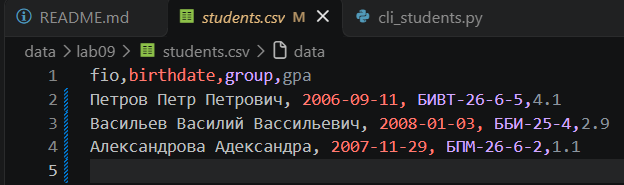

Добавление студента:

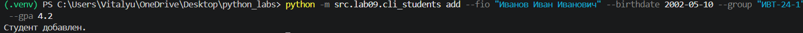

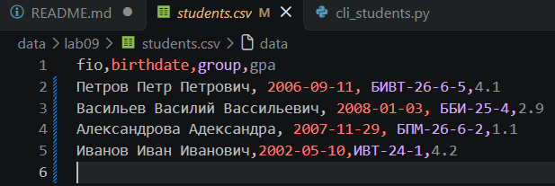

Вывод списка с сортировкой (GPA):

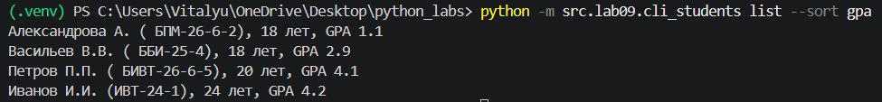

Вывод списка без сортировки:

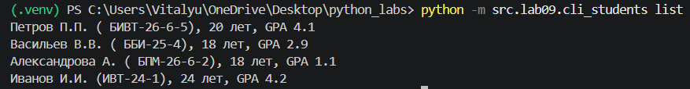

Поиск студента:

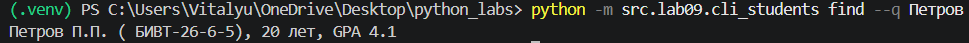

Неудачный поиск:

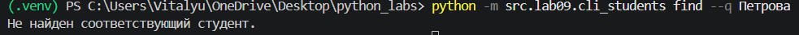

Обновление записи студента:

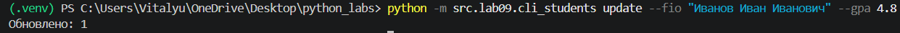

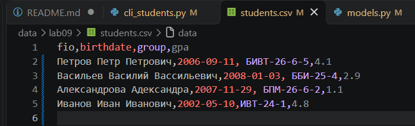

Удаление студента:

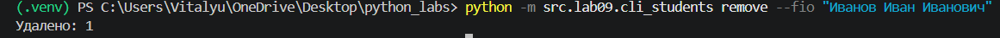

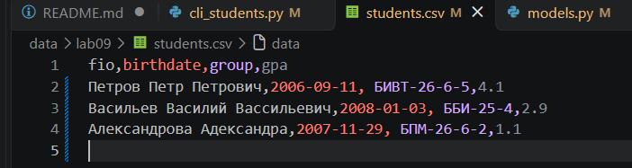

Попытка создания студента с неверным GPA:

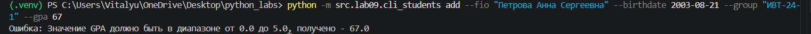

## Итоговый students.csv

После выполнения сценария файл `data/lab09/demo/students.csv` содержит:

```csv
fio,birthdate,group,gpa
Петров Петр Петрович,2006-09-11, БИВТ-26-6-5,4.1
Васильев Василий Вассильевич,2008-01-03, ББИ-25-4,2.9
Александрова Адександра,2007-11-29, БПМ-26-6-2,1.1
```

## Обработка ошибок

Некорректные данные и ошибки чтения/записи выводятся понятным сообщением в `stderr`; CLI возвращает код `1`. Например, модель проверяет формат даты, непустые ФИО и группу, а также диапазон GPA. Ошибки синтаксиса командной строки обрабатываются `argparse`.
